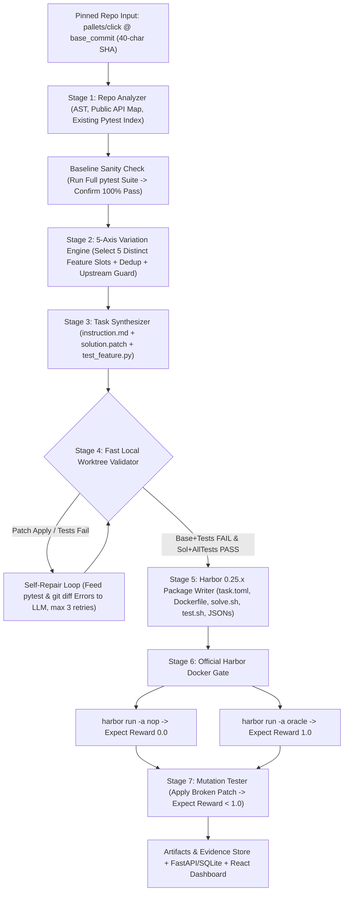
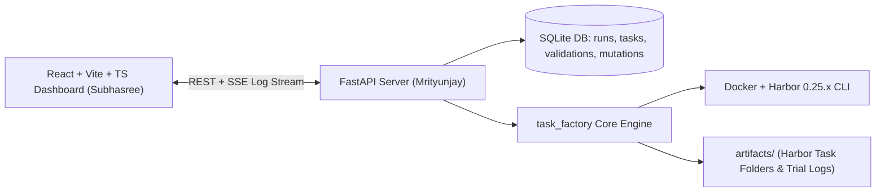

# System Architecture — Coding Task Factory

## 1. Architectural Principles

1. **CLI-First, Judge-Proof Core (`task_factory/`):**
   Judges execute submissions in a standardized Docker environment. Therefore, the entire pipeline (repo analysis $\rightarrow$ 5-axis variation $\rightarrow$ code/test synthesis $\rightarrow$ self-repair $\rightarrow$ Harbor packaging $\rightarrow$ Harbor validation) runs as a standalone, deterministic Python CLI (`python -m task_factory ...`) with zero dependency on a browser.
2. **Control Room Wrapper (`backend/` + `frontend/`):**
   A lightweight FastAPI + SQLite + React dashboard wraps `task_factory` so the team and demo viewers can trigger runs, stream live logs, inspect diffs, view Harbor `nop`/`oracle`/mutation matrices, and export task packages interactively.
3. **Two-Stage Validation for Speed & Accuracy:**
   - **Stage 1 (Fast Local Pre-Check & Self-Repair):** Uses an isolated Git worktree + cached Python venv (`pytest`) to validate patches and iterate LLM self-repair in ~2–5 seconds per attempt.
   - **Stage 2 (Official Harbor Docker Gate):** Packages passing tasks into Harbor `0.25.x` format and runs official `harbor run -a nop` (`0.0`), `harbor run -a oracle` (`1.0`), and mutation verification inside clean Docker containers.

---

## 2. End-to-End Pipeline Architecture

---

## 3. Component Design

### 3.1 `task_factory/repo_analyzer.py` — Codebase Intelligence
- Clones or reads local mirror of `pallets/click` and checks out exact `base_commit` (verifying clean `git status` and full `pytest` baseline).
- Parses `src/click/*.py` via Python `ast` to extract modules, classes (`Command`, `Group`, `Parameter`, `Option`, `Argument`, `Context`, `ParamType`), public functions, decorators, and docstrings.
- Indexes existing test files (`tests/test_*.py`) and collects full baseline `pytest --collect-only -q` node IDs (`pass_to_pass` baseline pool).
- Extracts recent release notes/symbols so the AI knows what already exists in `click` and avoids proposing already-implemented features.

### 3.2 `task_factory/variation_engine.py` — 5-Axis Variation Strategy
To guarantee **5 substantively different tasks** (never reworded duplicates), generation is anchored to **5 orthogonal architectural axes** of `pallets/click`:

| Axis ID | Canonical Slug | Target `click` Subsystem | Example Feature Category (Illustrative Only) | Behaviour Changed |
| :---: | :--- | :--- | :--- | :--- |
| **Axis 1** | `parameter-validation` | **Parameter & Type System** (`types.py`, `core.py`) | New parameter validation/constraint rules or type coercion modes | Input parsing, validation errors, value normalization |
| **Axis 2** | `command-routing` | **Command & Group Routing** (`core.py`, `decorators.py`) | Command dispatch, option-group rules, deprecation/alias policies, or lifecycle hooks | Invocation flow, resolution order, callback execution |
| **Axis 3** | `formatting-termui` | **Help & Terminal Formatting** (`formatting.py`, `termui.py`) | Structured help output customization, usage wrapping, or rich terminal helpers | Rendered stdout/stderr formatting & help sections |
| **Axis 4** | `context-envvar` | **Context, EnvVar & Config Resolution** (`core.py`, `globals.py`) | Precedence rules, dynamic defaults, or context propagation mechanisms | Value-source priority (CLI vs env vs default map) |
| **Axis 5** | `testing-completion` | **Testing & Shell Integration** (`testing.py`, `shell_completion.py`) | Enhanced `CliRunner` isolation/assertions or shell completion behaviour | Test harness APIs or completion script generation |

**Anti-Duplication & Scope Guards:**
- Rejects any proposal containing bug-fix language (*"fix crash", "resolve regression", "handle broken edge case"*).
- Checks symbol/keyword overlap against `base_commit` source & docstrings to prevent re-implementing existing `click` flags/classes.
- Computes pairwise semantic/structural overlap across the 5 chosen feature blueprints (ensuring distinct target symbols, distinct acceptance rules, and non-overlapping test assertions).

### 3.3 `task_factory/synthesizer.py` — Task Synthesis & Self-Repair
Uses structured LLM outputs to produce three cleanly separated artifacts per task:
1. **`instruction.md`**: Problem goal, exact public API contract (class/parameter/method signatures, CLI flags, error types, edge cases), non-goals, and zero test/patch spoilers.
2. **`solution.patch`**: Minimal, idiomatic git diff modifying `src/click/...` (never modifying `tests/`).
3. **Feature Tests (`tests/test_feature_<slug>.py`)**: Self-contained `pytest` suite using `click.testing.CliRunner` and standard `pytest` assertions — zero external network calls or external files outside temp dirs.

**Self-Repair Loop (Up to 3 Iterations):**
- Checks `git apply --check` on `solution.patch`.
- Runs `pytest` in a clean Git worktree:
  - Ensures feature tests **FAIL** on unpatched `base_commit` (if any feature test passes on base repo, prompts LLM to tighten/fix test!).
  - Applies `solution.patch` and runs both feature tests and full existing `click` test suite.
  - If any test fails, captures truncated traceback + failing assertion and sends back to LLM to fix either `solution.patch` or `test_feature_*.py` (never relaxing requirement fidelity).

### 3.4 `task_factory/harbor_writer.py` — Harbor `0.25.x` Packager
Translates a verified blueprint into a standalone Harbor folder (`artifacts/tasks/<task-id>/`) conforming strictly to [`TASK_INTERFACE.md`](./TASK_INTERFACE.md):
- Forces Unix `LF` (`\n`) line endings on `solution/solve.sh` and `tests/test.sh`.
- Writes `environment/Dockerfile` pinned to the exact 40-char `base_commit`.
- Separates `solution/` from `environment/` and `tests/` so no solution or feature tests leak into the base image seen by evaluated agents.

### 3.5 `task_factory/harbor_runner.py` & `mutation_tester.py` — Official Validation Gate
- Executes both official Harbor CLI commands (`nop` and `oracle`), parses `/logs/verifier/reward.txt` and trial metadata, and archives full trial logs under `artifacts/validation_evidence/<task-id>/`.
- **Mutation Tester `[P1 — see goodtohave.md]`:** Generates 2–3 controlled AST mutants per task (e.g., inverting a conditional branch, returning default early, omitting validation error) and verifies `reward < 1.0`, proving the test suite actively detects incorrect implementations.

---

## 4. Control Room Architecture (`backend/` + `frontend/`)

### SQLite Schema Overview (`backend/db`)
- **`runs`**: `id`, `repo_name`, `base_commit`, `target_count`, `status` (`queued|running|completed|failed`), `model_used`, `created_at`, `completed_at`
- **`tasks`**: `id`, `run_id`, `slug`, `axis`, `title`, `files_touched_json`, `fail_to_pass_count`, `pass_to_pass_count`, `repair_attempts`, `stage1_passed`, `package_path`
- **`validations`**: `id`, `task_id`, `mode` (`nop|oracle|mutant`), `reward` (`float|null`), `passed_feature`, `total_feature`, `passed_regression`, `total_regression`, `duration_sec`, `log_path`, `created_at`

### Core API Endpoints
- `POST /api/runs` — Start a new generation run (`repo`, `base_commit`, `count`, optional `axes`, `run_harbor`, optional `[P1]` `run_mutations`)
- `GET /api/runs/{run_id}` — Run status and summary metrics
- `GET /api/runs/{run_id}/events` — SSE live log & pipeline stage updates
- `GET /api/tasks` & `GET /api/tasks/{task_id}` — Full task package inspector (`instruction.md`, `task.toml`, diffs, test lists)
- `POST /api/tasks/{task_id}/validate` — Trigger official Harbor `nop` + `oracle` checks
- `POST /api/tasks/{task_id}/mutate` `[P1]` — Trigger mutation tests and return kill rate
- `GET /api/tasks/{task_id}/export` — Download zipped Harbor task folder
