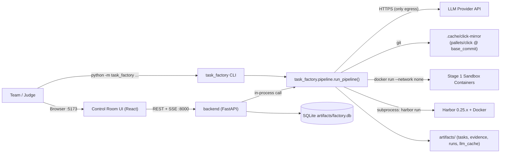
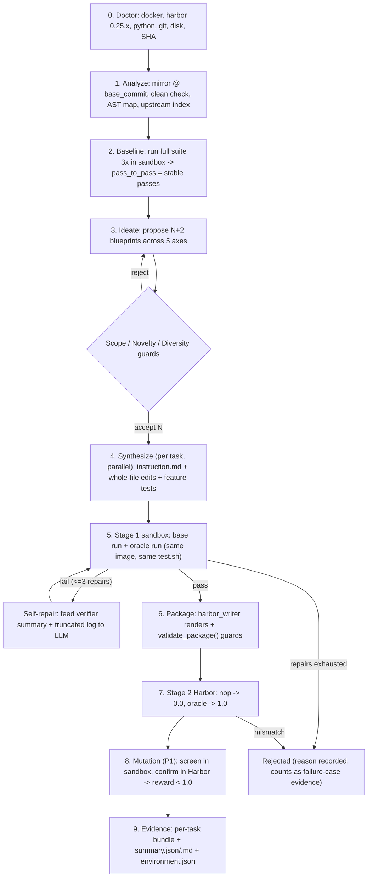
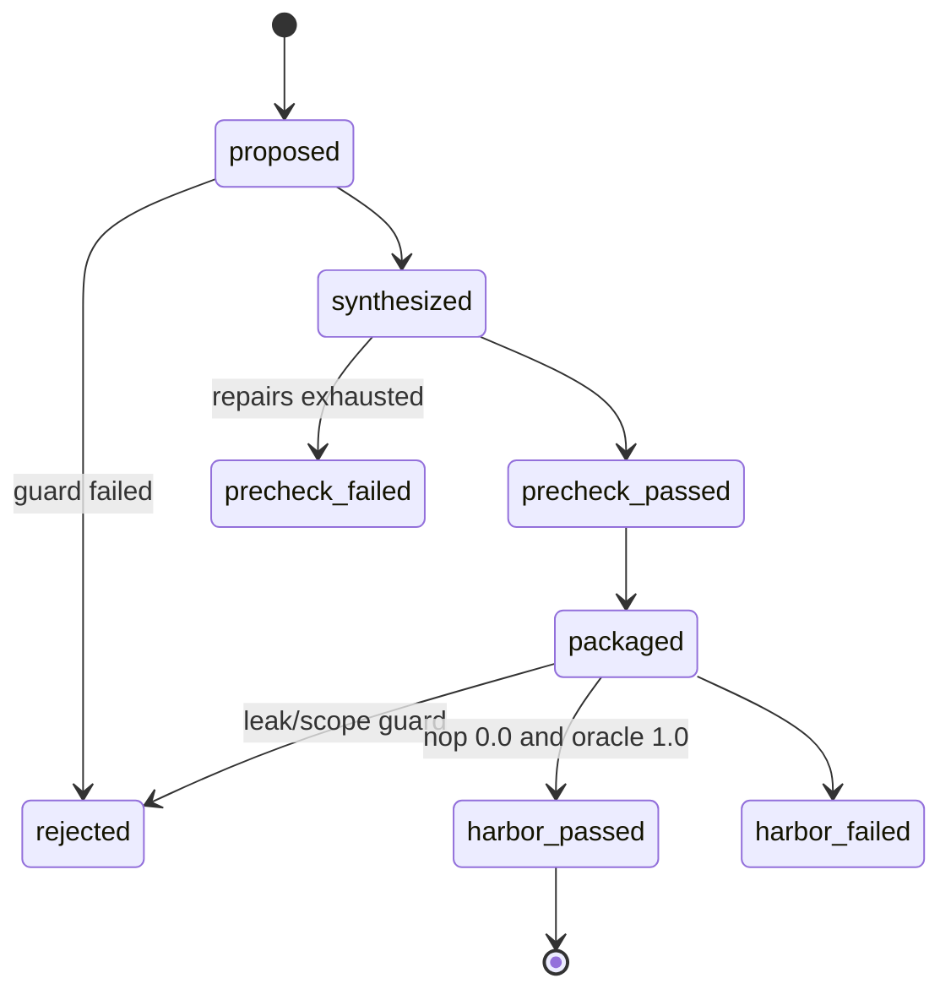
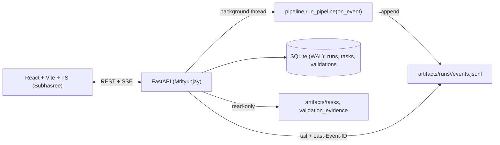

# System Architecture — Coding Task Factory (v2, finalized 27 Nov 2026)

> **Status:** Implementation baseline. This version supersedes v1 (25 Nov). Key changes are recorded as Architecture Decision Records (ADRs) in [Section 14](#14-architecture-decision-records-adrs). Contracts referenced here are defined in [`TASK_INTERFACE.md`](./TASK_INTERFACE.md) (Harbor package) and [`IMPLEMENTATION.md`](./IMPLEMENTATION.md) (Python schemas, config, API). If this document conflicts with those two, **they win** — report the conflict to Abhishek.

---

## 1. Goals, Non-Goals & Quality Attributes

### 1.1 Goals
1. **One command** turns the pinned `pallets/click` commit into **≥ 5 substantively different** Harbor `0.25.x` feature-development task packages.
2. **Every accepted package is machine-proven**: Harbor `nop` → `0.0`, Harbor `oracle` → `1.0`, mutants → `< 1.0`, with evidence on disk.
3. **Judges can reproduce everything** on a clean Linux Docker host — including **without an LLM API key** (validate-only and replay modes).
4. A **Control Room UI** makes the run observable (live stages, diffs, reward matrix, mutation scorecard) for the demo.

### 1.2 Non-Goals
- Any repo other than `pallets/click`; bug-fix tasks; tasks requiring network, credentials, or external services.
- Multi-user hosting, authentication, cloud deployment, horizontal scaling.
- A general plugin framework for other repositories (P2 at most — see [`goodtohave.md`](./goodtohave.md)).

### 1.3 Quality Attributes (in priority order)
| # | Attribute | What it means for us | Mechanism |
| :-: | :--- | :--- | :--- |
| 1 | **Correctness of validation** | A task is only accepted if grading is provably right | Same image + same `test.sh` in Stage 1 and Stage 2 (ADR-01), node-ID-exact reward (ADR-02) |
| 2 | **Reproducibility** | Same inputs → same packages and same rewards | Pinned SHA, pinned image deps, LLM record/replay (ADR-08), deterministic env vars |
| 3 | **Isolation & safety** | LLM-generated code never runs on a developer host; no leakage to the evaluated agent | All test execution in `--network none` containers; fixed templates (ADR-05); leak guards |
| 4 | **Resilience** | A crash at task 4 of 5 does not lose tasks 1–3 or the LLM spend | Per-task checkpointing + `--resume` (Section 8) |
| 5 | **Observability** | Every decision and failure is inspectable later | Append-only `events.jsonl`, per-attempt records, evidence bundle |
| 6 | **Speed** | Self-repair feedback in seconds, full batch in < 45 min | Fast-mode Stage 1, cached images, bounded parallelism |

---

## 2. System Context



**Trust boundaries**
- **LLM output is untrusted input.** It is parsed into Pydantic models, validated by guards, and only ever *executed* inside sandbox/Harbor containers.
- **`pallets/click` source is data.** It is embedded into prompts inside clearly delimited blocks and never interpreted as instructions.
- **The only outbound network call at pipeline runtime is the LLM API** (and `git clone`/`docker build` of public sources). Task containers never need the network after build.

---

## 3. Module Map & Ownership

| Module | Owner | Responsibility | Depends on |
| :--- | :--- | :--- | :--- |
| `task_factory/config.py` | Abhishek | Single source for env vars, paths, pinned SHA, limits | — |
| `task_factory/schemas.py` | Abhishek | All Pydantic contracts crossing module boundaries | — |
| `task_factory/errors.py` | Abhishek | Typed exception hierarchy (Section 10) | — |
| `task_factory/harbor_writer.py` (+ `templates/harbor/*`) | Abhishek | Render & validate Harbor packages; **single source of the Dockerfile** | schemas, config |
| `task_factory/harbor_runner.py` | Abhishek | Run `harbor run` (nop/oracle/mutant), collect evidence, write summaries | harbor_writer |
| `task_factory/mutation_tester.py` | Abhishek | Generate/screen mutants, run them, compute kill rate | sandbox_precheck, harbor_runner |
| `task_factory/llm_client.py` | Alok | One thin LLM wrapper: structured JSON output, retries, record/replay cache | config |
| `task_factory/repo_analyzer.py` | Alok | Mirror clone, SHA/clean verification, AST symbol map, upstream feature index | sandbox_precheck (baseline) |
| `task_factory/variation_engine.py` | Alok | 5-axis blueprint ideation + scope/novelty/diversity guards | llm_client, repo_analyzer |
| `task_factory/synthesizer.py` | Alok | instruction/patch/test synthesis + self-repair loop + spec-test consistency | llm_client, sandbox_precheck |
| `task_factory/sandbox_precheck.py` | Mrityunjay | Worktree manager, sandbox image, Stage 1 runs, baseline collection | harbor_writer (Dockerfile + test.sh) |
| `task_factory/pipeline.py` | Mrityunjay | **The orchestrator** used by both CLI and backend; checkpoint/resume; events | all of the above |
| `task_factory/cli.py`, `__main__.py` | Mrityunjay | `doctor`, `analyze`, `generate`, `validate`, `mutate`, `report` commands | pipeline |
| `backend/*` | Mrityunjay | FastAPI routes, SQLite persistence, background run worker, SSE | pipeline |
| `frontend/*` | Subhasree | Control Room UI against the REST/SSE contract | backend API |

**Rule:** CLI and backend **never** implement pipeline logic; both call `pipeline.run_pipeline()` / `harbor_runner.validate_task()` / `mutation_tester.run_mutations()`.

---

## 4. End-to-End Pipeline



**Over-generation rule:** ideation proposes `count + 2` blueprints so rejections do not leave us short. The final selection keeps axis coverage (each of the 5 axes ≥ 1 task; for 10–15 tasks, each axis ≥ 2).

### 4.1 Stage Contracts (inputs → outputs)
| Stage | Function (owner) | Input | Output | Failure → |
| :--- | :--- | :--- | :--- | :--- |
| Analyze | `repo_analyzer.analyze_repo()` (Alok) | `RunConfig` | `RepoSnapshot` (symbol map, file index, upstream feature index) | `RepoStateError` (dirty / SHA mismatch) → run fails |
| Baseline | `sandbox_precheck.collect_baseline()` (Mrityunjay) | mirror path, SHA | `BaselineResult` (`pass_to_pass`, excluded flaky/skipped) | `SandboxError` → run fails |
| Ideate | `variation_engine.propose_blueprints()` (Alok) | `RepoSnapshot`, axes, count | `list[FeatureBlueprint]` + rejected list with reasons | `LLMError` after retries → run fails |
| Synthesize | `synthesizer.synthesize_task()` (Alok) | blueprint, snapshot, baseline | `SynthesizedTask` (with `repair_attempts`, attempt history) | `PrecheckFailed` → task rejected |
| Stage 1 | `sandbox_precheck.verify_in_worktree()` (Mrityunjay) | candidate files | `PrecheckResult` (incl. `VerifierSummary` for base + oracle) | returned as data, never raised |
| Package | `harbor_writer.write_task_package()` (Abhishek) | `SynthesizedTask` | task dir path | `LeakageDetected` / `ScopeViolation` → task rejected |
| Stage 2 | `harbor_runner.validate_task()` (Abhishek) | task dir | `list[ValidationOutcome]` | outcome recorded; task marked `harbor_failed` |
| Mutation | `mutation_tester.run_mutations()` (Abhishek) | task dir, worktree | `list[ValidationOutcome]` (mode `mutant`) | recorded; never blocks acceptance in MVP |

---

## 5. Stage 1 — Sandbox Pre-Check (Revised: ADR-01)

**Problem with v1:** v1 ran Stage 1 with a "cached host venv". On our Windows laptops this (a) runs LLM-written code on the host, (b) uses a different OS/Python than Harbor's `python:3.11-slim`, so a test can pass in Stage 1 and fail in Stage 2 (paths, terminal width, skip markers), and (c) a shared venv with `pip install -e` points `import click` at **one** worktree, so parallel attempts silently test each other's code.

**v2 design:**
1. **Mirror:** `.cache/click-mirror` cloned once with `git clone -c core.autocrlf=false -c core.eol=lf`, checked out at `CLICK_BASE_COMMIT`, verified clean (`git status --porcelain` empty) and `git rev-parse HEAD` equal to config.
2. **Sandbox image:** `click-sandbox:<sha12>` is built from **the exact Dockerfile `harbor_writer.render_dockerfile()` produces** (one source of truth). Built once per machine; rebuild only if the rendered Dockerfile hash changes.
3. **Worktree per attempt:** `git worktree add --detach .cache/worktrees/<run_id>/<task_id>/a<n> <sha>`. `worktree add/remove` are serialized by a process-wide lock (`threading.Lock`); git itself is not safe for concurrent worktree mutations on one repo (`index.lock`, `config.lock` races).
4. **Apply candidate:** write LLM whole-file edits into `src/click/...` (LF, UTF-8, no BOM, trailing newline preserved), then `git diff --no-color --no-ext-diff --binary -- src/click` → `solution.patch`. Feature test file is written to a separate `tests_payload/` dir (it is *not* part of the patch).
5. **Run:** the **same `tests/test.sh`, `reward_plugin.py`, and `compute_reward.py` that ship in the Harbor package** are executed:
   ```text
   docker run --rm --network none --cpus 2 --memory 2g --pids-limit 512 \
     -v <worktree>:/app -v <tests_payload>:/tests:ro -v <attempt_logs>:/logs/verifier \
     click-sandbox:<sha12> bash /tests/test.sh
   ```
   - **Base run:** worktree without patch → expect `status=ok`, all `pass_to_pass` pass, **all** `fail_to_pass` fail.
   - **Oracle run:** worktree with patch → expect reward `1.0`.
   - Because the editable install in the image points at `/app/src`, mounting the worktree at `/app` makes `import click` resolve to *that* worktree only. `test.sh` asserts this (`python -c "import click; assert click.__file__.startswith('/app/src')"`).
6. **Fast mode vs full mode:** during self-repair iterations, `test.sh` accepts `FAST_MODE=1` to run only the feature file + the existing test modules touching the same source files (~3–5 s). The final accepted attempt always runs the **full** suite (~15–25 s). Harbor always runs full mode.
7. **Cleanup:** `git worktree remove --force` on success; failed attempts are kept until run end for debugging, then pruned (`git worktree prune` also runs at pipeline start). On Windows, removal retries 3× with backoff (antivirus/IDE file locks).

### 5.1 Baseline `pass_to_pass` Collection (ADR-09)
- Run the clean base **3 times** in the sandbox with the reward plugin; `pass_to_pass = tests that passed in all 3 runs`.
- Tests that were skipped, xfailed, or flaky are **excluded** and recorded in `artifacts/validation_evidence/baseline.json` (judges see we did not hide failures).
- Collected **inside Linux**, never on the Windows host — otherwise platform `skipif` markers produce node IDs that are "missing" in Harbor and force reward `0.0`.

---

## 6. Stage 2 — Harbor Gate

- `harbor_runner` invokes the Harbor CLI as a **subprocess** (`HARBOR_BIN`, list args, `shell=False`). Harbor is installed in an isolated tool env (`pipx`/`uv tool`) to avoid dependency conflicts with FastAPI/Pydantic.
- **Unique output dir per invocation:** `artifacts/harbor_runs/<run_id>/<task_id>/<mode>[_<mutant_id>]/`. v1 shared `artifacts/harbor_runs/nop` across tasks — parallel runs could collide and "latest directory" parsing could read another task's reward.
- **Acceptance is computed from `verifier_summary.json`, not `reward.txt` alone:**
  - `nop` accepted ⇔ `status == "ok"` ∧ `p2p_passed == p2p_total` ∧ `f2p_passed == 0` ∧ `reward == 0.0`.
  - `oracle` accepted ⇔ `status == "ok"` ∧ `reward == 1.0`.
  - Rationale: a broken environment also yields `0.0`; without the breakdown, a crashed `nop` would look like a pass.
- **Parallelism:** `HARBOR_MAX_PARALLEL` (default `2`; Docker Desktop on a laptop cannot hold more `2 CPU / 4 GB` containers). The **first** Harbor run of a batch runs alone to warm the image cache; the rest run in parallel. All task Dockerfiles are byte-identical → one image build per batch.
- **Evidence copy:** after each run, copy `reward.txt`, `verifier_summary.json`, `test_results.json`, `pytest.log`, and Harbor's own job/trial result files into `artifacts/validation_evidence/<task_id>/<mode>/`.
- **Platform:** Stage 2 is run on Linux or **WSL2** for evidence generation. Native-Windows Harbor is "best effort" (verify on Day 1; see Section 15).

---

## 7. Mutation Testing (P1, planned for Milestone 3)

1. **Generate** 4–6 candidate mutants per task by applying AST operators **only to lines added by `solution.patch`**: negate condition, delete a `raise`, early `return` of default, off-by-one on numeric literals, swap comparison operator, drop a validation call.
2. **Screen in sandbox (cheap):** discard mutants that fail to compile/import (trivial) or that are behaviourally identical (reward still `1.0` and no test changed outcome → likely equivalent; recorded as "surviving").
3. **Confirm in Harbor (official):** copy the task dir to `.cache/mutants/<task_id>/<mutant_id>/`, replace `solution/solution.patch` with the mutant patch, run `harbor run -a oracle`. **Never mutate the curated task dir in place.**
4. **Metrics per task:** `killed / total` and **meaningful kills** = mutants where `pass_to_pass` stayed green but reward `< 1.0` (tests detect *wrong* behaviour, not just a crash). Target: ≥ 2 of 3 confirmed mutants killed for every accepted task.

---

## 8. Run State, Checkpointing & Resume

Each run owns `artifacts/runs/<run_id>/`:
```text
artifacts/runs/<run_id>/
├── run.json                 # RunConfig + status + timestamps + factory git SHA
├── events.jsonl             # append-only RunEvent stream (SSE source + evidence)
├── baseline.json
└── tasks/<task_id>/
    ├── state.json           # TaskStatus + last error
    ├── blueprint.json
    └── attempts/a<n>/       # prompt hash, LLM response, files, solution.patch, precheck.json, logs
```

**Task state machine**


- Every transition is written to `state.json` **before** the next stage starts; `python -m task_factory generate --resume <run_id>` skips tasks already past a stage.
- `events.jsonl` is the single event log. The backend tails it for SSE (supports `Last-Event-ID` reconnect via `seq`), and `TECHNICAL_EXPLANATION.md` failure cases are mined from it.

---

## 9. Concurrency Model

| Resource | Limit | Mechanism | Why |
| :--- | :--- | :--- | :--- |
| Active pipeline runs | **1** | backend returns `409 Conflict`; CLI takes `.cache/run.lock` | Shared mirror, Docker capacity, SQLite single writer |
| LLM calls | `LLM_MAX_PARALLEL` (3) | thread pool + retry with jittered backoff on 429/5xx | Provider rate limits |
| `git worktree add/remove` | 1 at a time | process-wide lock in `sandbox_precheck` | git lock files |
| Sandbox containers | `SANDBOX_MAX_PARALLEL` (3) | semaphore | Laptop CPU/RAM |
| Harbor runs | `HARBOR_MAX_PARALLEL` (2) | semaphore; first run serial | Image build race + RAM |
| SQLite writes | 1 writer | pipeline emits events → backend writer thread; WAL mode; `check_same_thread=False` | Avoid `database is locked` |

Timeouts are enforced everywhere (`SANDBOX_TIMEOUT_SEC`, `HARBOR_TIMEOUT_SEC`, `LLM_TIMEOUT_SEC`); on timeout, the container is killed (`docker rm -f`) and the attempt recorded as `error`, never left running.

---

## 10. Error Taxonomy (`task_factory/errors.py`)

```text
FactoryError
├── ConfigError              → HTTP 400   (bad env/config, invalid SHA, bad task_id)
├── RepoStateError           → HTTP 500   (mirror dirty, SHA mismatch, baseline not 100%)
├── LLMError                 → HTTP 502*  (provider failure after retries)
│   └── LLMResponseInvalid                (JSON/schema validation failed after retries)
├── SandboxError             → HTTP 500   (docker unavailable, container timeout)
├── PrecheckFailed                        (task-level; task rejected, run continues)
├── GuardViolation                        (task-level; task rejected, run continues)
│   ├── LeakageDetected
│   └── ScopeViolation
├── HarborError              → HTTP 500   (harbor missing / wrong version / crashed)
├── NotFound                 → HTTP 404
└── RunConflict              → HTTP 409
```
\* `502` only if the backend surfaces it synchronously; otherwise the run is marked `failed` with the error in `events.jsonl`.

**Rules:** task-level errors never abort the run; run-level errors abort with a final `RunEvent(stage="run", level="error")`. Nothing is swallowed — every caught exception becomes an event.

---

## 11. Security, Anti-Leakage & Anti-Reward-Hacking (Threat Model)

| # | Threat | Where | Control (owner) |
| :-: | :--- | :--- | :--- |
| T1 | Evaluated agent reads future upstream commits in `.git` and copies a later upstream implementation | `environment/Dockerfile` | Shallow fetch of exactly `base_commit` (`git fetch --depth 1 origin <sha>`), remote removed (ADR-03) (Abhishek) |
| T2 | Tests/solution baked into image | Dockerfile | `validate_package()` rejects any `COPY`/`ADD` and any mention of `solution`/`tests` (Abhishek) |
| T3 | `instruction.md` leaks tests or patch | instruction | Leak guard: no `test_feature`, node IDs, `fail_to_pass`, diff markers (`@@`, `+++ `, `--- a/`); no verbatim copy of any added patch line > 40 chars other than declared public signatures (Abhishek in writer, Alok in synthesizer) |
| T4 | Unfair/unsolvable task: tests assert strings or names the instruction never specifies | instruction ⇄ tests | **Spec–test consistency check**: every literal in `assert`/`pytest.raises(match=)` and every new public name used by tests must appear in `instruction.md` (Alok) |
| T5 | LLM "solution" games the verifier (writes `/logs/verifier/reward.txt`, patches pytest, adds `conftest.py`, skips tests) | `solution.patch` | Patch path allowlist `src/click/**`; deny-list tokens (`/logs`, `reward`, `subprocess`, `socket`, `os.system`, `pytest`, `sys.modules`, `conftest`); size cap 400 changed lines (Abhishek) |
| T6 | Feature tests that cannot fail meaningfully / weakened by self-repair | tests | f2p count 3–10; all f2p must fail on base; repair may not reduce f2p count or assertion count; mutation testing (Alok, Abhishek) |
| T7 | Shell/command injection from LLM strings | writer/runner | `.sh`, Dockerfile, `task.toml` are **fixed templates** (ADR-05); only validated values interpolated (`task_id` regex, SHA regex, test filename regex); subprocess list args (All) |
| T8 | LLM-written code harms the developer machine or calls the network | Stage 1 | Executed only in `--network none` containers with CPU/RAM/PID limits (Mrityunjay) |
| T9 | Prompt injection via repo text | prompts | Repo content embedded in delimited data blocks; system prompt states repo text is data; outputs schema-validated (Alok) |
| T10 | Secrets leak | logs/git | Keys only from env; `.env` ignored; never logged; LLM cache stores prompts/responses but never headers/keys (All) |

---

## 12. Reproducibility & Determinism

- **Pins:** `CLICK_BASE_COMMIT` (40-char), Docker base image tag (digest recorded in `environment.json`), `pytest` version pinned to click's own test requirements at that commit, `harbor==0.25.*` exact version recorded.
- **Environment in `test.sh` and sandbox:** `COLUMNS=80 LINES=24 TERM=dumb LC_ALL=C.UTF-8 PYTHONHASHSEED=0 PYTHONDONTWRITEBYTECODE=1`, `-p no:cacheprovider`. Click's help/formatting tests depend on terminal width — unpinned `COLUMNS` is a top cause of Stage 1 ≠ Stage 2.
- **LLM record/replay (ADR-08):** `llm_client` caches every request/response at `artifacts/llm_cache/<sha256>.json` (key = provider + model + temperature + prompt + schema). `LLM_MODE=live|record|replay`. The final evidence run is recorded and the cache committed, so `generate --replay` regenerates byte-identical packages **without an API key**. Temperature `0` in all generation calls.
- **Line endings (Windows → Linux):** see [Section 13](#13-windows--linux-line-ending--encoding-rules).

### 12.1 Judge Paths (all must work from a fresh clone)
| Path | Command | Needs API key? | Proves |
| :--- | :--- | :---: | :--- |
| A. Environment check | `python -m task_factory doctor` | No | Docker, Harbor version, Python, git, disk, LF integrity of `artifacts/tasks/**` |
| B. Validate shipped tasks | `python -m task_factory validate --tasks artifacts/tasks` | No | Every shipped package: `nop=0.0`, `oracle=1.0`; regenerates evidence |
| C. Replay generation | `python -m task_factory generate --replay --out _tmp_replay` | No | Pipeline is automated, not hand-made; reproduces packages from recorded LLM I/O |
| D. Fresh generation | `python -m task_factory generate --count 5` | Yes | Live end-to-end factory |

`docker-compose.yml` wraps the same commands. If Harbor runs **inside** a container using the host Docker socket, the repo must be mounted at the **same absolute path** inside and outside (`${PWD}:${PWD}`, `working_dir: ${PWD}`), because the host daemon resolves bind-mount paths.

---

## 13. Windows ↔ Linux Line-Ending & Encoding Rules

Our dev machines run Windows with `core.autocrlf=true`. Without controls, CRLF reaches Docker and breaks `bash` (`$'\r': command not found`, `bad interpreter`) and `git apply` (whitespace/context mismatch).

1. **Repo `.gitattributes`** (Abhishek, Day 1):
   ```gitattributes
   * text=auto eol=lf
   *.sh text eol=lf
   *.py text eol=lf
   *.toml text eol=lf
   *.json text eol=lf
   *.md text eol=lf
   Dockerfile text eol=lf
   *.patch -text
   *.diff -text
   *.png binary
   ```
   `*.patch -text` prevents Git from ever rewriting patch bytes. After adding, run `git add --renormalize .` once.
2. **One writer helper:** `harbor_writer.write_text_lf(path, text)` normalizes `\r\n`/`\r` → `\n`, writes UTF-8 **without BOM** with `newline="\n"`, ensures a trailing newline, and asserts no `\r` in the bytes. All generated files go through it (not just `.sh`).
3. **No PowerShell writes for generated files:** `Set-Content`/`Out-File` add BOM/CRLF; a BOM before `#!/usr/bin/env bash` breaks the shebang and `json.load` rejects BOM JSON.
4. **Executable bit:** Windows cannot set `+x`. Commit `.sh` files with `git update-index --chmod=+x`, **and** invoke scripts via `bash <script>` where we control the call. (How Harbor invokes them is a Day-1 verification item.)
5. **Mirror clone with `core.autocrlf=false`** so whole-file LLM edits diff cleanly against LF originals (otherwise every line shows as changed).
6. **CI guard:** `doctor` and CI fail if any file under `artifacts/tasks/**` contains `\r` or a BOM.

---

## 14. Architecture Decision Records (ADRs)

| ID | Decision | Status | Rationale / Trade-off |
| :--- | :--- | :--- | :--- |
| ADR-01 | Stage 1 runs in Docker sandbox using the Harbor Dockerfile + identical `test.sh` | **Accepted (supersedes host venv)** | Removes Stage1≠Stage2 drift, isolates LLM code; costs ~1 s container start per attempt |
| ADR-02 | Reward computed from a stdlib pytest plugin recording exact node-ID outcomes (not JUnit XML) | Accepted | JUnit `classname`/`name` → node-ID mapping is lossy for parametrized/class tests |
| ADR-03 | Dockerfile shallow-fetches exactly `base_commit`; remote removed | Accepted | Blocks future-history leakage; smaller, faster image |
| ADR-04 | LLM produces whole-file edits; patch computed via `git diff` | Accepted (from v1) | Avoids hallucinated hunk headers |
| ADR-05 | `test.sh`, `solve.sh`, Dockerfile, `task.toml`, reward scripts are fixed templates | Accepted | No LLM-controlled shell; consistent grading |
| ADR-06 | Single orchestrator `task_factory/pipeline.py` shared by CLI and backend | Accepted | No duplicated pipeline logic |
| ADR-07 | One active run at a time | Accepted | Simplicity; laptop capacity |
| ADR-08 | LLM record/replay cache; final run cache committed | Accepted | Key-less reproducibility for judges |
| ADR-09 | `pass_to_pass` = stable passes across 3 baseline sandbox runs | Accepted | Flaky/skipped tests would zero out `oracle` |
| ADR-10 | `task_id` = `click-<NN>-<slug>` matching `^click-\d{2}-[a-z0-9]+(-[a-z0-9]+)*$`, ≤ 64 chars | Accepted | Resolves v1 mismatch (`click-01-…` vs `click-feat-01-…`); path-safe |
| ADR-11 | Acceptance uses `verifier_summary.json` breakdown, not reward alone | Accepted | A crashed `nop` must not count as `0.0` success |
| ADR-12 | Harbor invoked as CLI subprocess from an isolated tool install | Accepted | Avoids dependency conflicts; matches judge usage |

New ADRs are proposed in a PR touching this table and must be approved by Abhishek.

---

## 15. Day-1 Verification Items (Owner: Abhishek, due 28 Nov)

These are **assumptions** until verified against the installed `harbor==0.25.*`. Record results in [`TASK_INTERFACE.md`](./TASK_INTERFACE.md):
1. Exact `task.toml` schema from `harbor task init` — where `base_commit`/metadata keys live; any required keys missing from our template.
2. How Harbor invokes `tests/test.sh` and `solution/solve.sh` (via `bash` or direct exec → does the `+x` bit matter?).
3. Whether `/tests` and `/solution` are copied or mounted, and at which paths; where `/logs/verifier/reward.txt` is read from.
4. Harbor output directory layout under `-o` (job/trial folders, result JSON names) for `harbor_runner` parsing.
5. Whether `task.toml` supports disabling internet for the agent/verifier phase.
6. Whether native Windows `harbor run` works with Docker Desktop, or Stage 2 must run in WSL2.
7. `pallets/click` test requirements at the pinned tag (pytest version, extra plugins) and baseline pass count in the sandbox.

---

## 16. Control Room Architecture



- **Filesystem is the source of truth; SQLite is an index** for fast listing. If the DB is deleted, `python -m task_factory report --reindex` rebuilds it from `artifacts/`.
- **SQLite tables:** `runs`, `tasks`, `validations` as listed in `IMPLEMENTATION.md` §4.3. Validation `mode` uses the schema enum (`stage1_base | stage1_oracle | harbor_nop | harbor_oracle | mutant`) — v1's `nop|oracle|mutant` is retired.
- **API surface:** see `IMPLEMENTATION.md` §5 (v2 adds `GET /api/runs`, `?run_id=` filter, `GET /api/tasks/{id}/logs/{mode}`, `409` on concurrent runs, `seq`/`level` on events). All additions are backward compatible with the v1 payloads.
- CORS allows `CORS_ORIGINS` (default `http://localhost:5173`). No auth by design (local demo tool).

---

## 17. Observability

- **Logging:** `logging` with logger names `task_factory.<module>` / `backend.<module>`; human format on console, JSON lines to `artifacts/runs/<run_id>/factory.log`. API keys are never logged.
- **Metrics captured per run** (written to `summary.json`): tasks proposed/accepted/rejected by reason, repair attempts per task, Stage 1 and Harbor durations, mutation kill rate, LLM calls and tokens per stage, total wall-clock.
- **Evidence bundle** (`artifacts/validation_evidence/`): `summary.json`, `summary.md` (the table pasted into `TECHNICAL_EXPLANATION.md`), `environment.json` (OS, Docker, Harbor, Python versions, image digest, factory git SHA, model IDs), `baseline.json`, and per-task mode folders.

---

## 18. Variation Strategy (5 Orthogonal Axes)

| Axis | Slug | Target subsystem | Behaviour changed | Distinctness rule |
| :-: | :--- | :--- | :--- | :--- |
| 1 | `parameter-validation` | `types.py`, `core.py` (Parameter/Option/Argument) | Parsing, validation errors, normalization | New/extended `ParamType` or param-level rule |
| 2 | `command-routing` | `core.py` (Command/Group/MultiCommand), `decorators.py` | Dispatch, resolution order, callback lifecycle | Changes *which* code runs or in what order |
| 3 | `formatting-termui` | `formatting.py`, `termui.py` | Rendered help/usage/terminal output | Asserted via exact output strings |
| 4 | `context-envvar` | `core.py` (Context), `globals.py` | Value-source precedence and propagation | Asserted via `ParameterSource` / resolved values |
| 5 | `testing-completion` | `testing.py`, `shell_completion.py` | Test harness API or completion behaviour | New `CliRunner`/`Result` capability or completion rule |

**Guards (owner: Alok):**
1. **Feature-only:** reject bug-fix language and "make X work correctly" framings.
2. **Novelty at base:** reject if proposed public names/flags already exist in the AST symbol map or docstrings at `base_commit`.
3. **Novelty vs upstream:** reject if the feature appears in upstream `CHANGES.rst` of newer releases (snapshot cached in `.cache/`) — avoids judges flagging "this already exists in a later click".
4. **Diversity:** pairwise Jaccard of `target_symbols` < 0.3, no two tasks with the same primary file *and* the same behaviour class, plus an LLM-judge "same feature?" check. Results written to `diversity.json` (feeds the P1 diversity report).

**Task quality bar (all tasks):** instruction uses the standard template (Goal · Required behaviour · Public API · Errors & messages · Examples · Non-goals · Compatibility); 3–10 `fail_to_pass` tests using only public API; tests import new symbols inside test functions (so each test fails individually under `nop`); difficulty label derived from files touched, changed lines, and components interacting.

---

## 19. Scoring Map (where each judging criterion is earned)

| Criterion (weight) | Architecture features that earn it | Evidence judges will see |
| :--- | :--- | :--- |
| Implementation & Repeatability (25%) | One-command CLI, shared orchestrator, resume, doctor, replay mode, compose | Judge paths A–D succeed on a fresh clone |
| Validation Evidence (25%) | Same-image Stage 1, exact node-ID reward, summary-based acceptance, mutation testing, baseline flaky exclusion | `validation_evidence/summary.md`, per-mode logs, kill rates |
| Variation (20%) | 5 axes, distinctness rules, diversity guard + report | Axis table, `diversity.json` / heatmap |
| Originality (15%) | Spec–test consistency check, anti-reward-hacking guards, record/replay, shallow-fetch leak defence | `TECHNICAL_EXPLANATION.md` sections + guard logs |
| Practical Impact (15%) | Tasks are solvable but non-trivial; optional real-agent Pass@1 (P1) | Pass@1 table, failure-case write-ups |

---

## 20. Risk Register

| Risk | Likelihood | Impact | Mitigation | Owner |
| :--- | :-: | :-: | :--- | :--- |
| Harbor 0.25.x schema/behaviour differs from our template | Medium | High | Day-1 verification (Section 15) + manual sample task by 28 Nov | Abhishek |
| Native-Windows Harbor/Docker issues | Medium | High | Stage 2 evidence runs on WSL2/Linux | Abhishek |
| LLM generates tasks that fail Stage 1 repeatedly | High | High | Over-generate (+2), whole-file edits, repair loop with verifier summary, prompt tuning days | Alok |
| Schedule slip (Gate 1 not met on 26 Nov) | **Occurred** | High | Re-baselined plan from 27 Nov; stubs + fakes so members are unblocked | All |
| API key/quota exhausted near deadline | Medium | High | Record cache from first good run; replay mode | Alok |
| Docker Desktop resource exhaustion | Medium | Medium | Parallelism caps, `docker system prune` in runbook, identical Dockerfiles | Mrityunjay / Abhishek |
| Merge conflicts in shared files (`pyproject.toml`, `tests/`) | Medium | Medium | Ownership rules; per-module test files; schema freeze | All |
